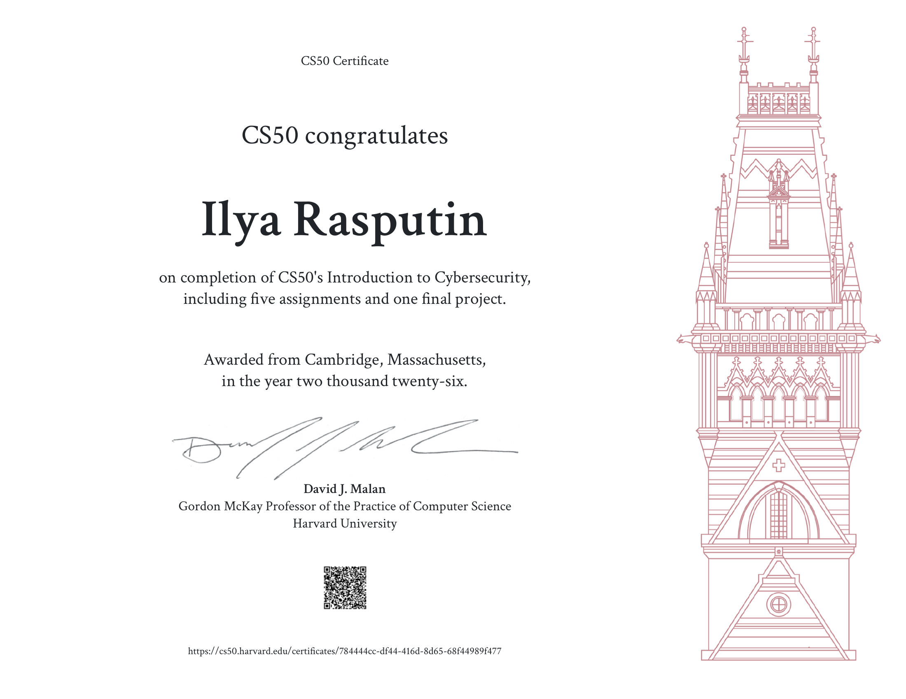

# CS50's Introduction to Cybersecurity - Harvard University

Certificate of completion for **CS50's Introduction to Cybersecurity** from **Harvard University**.

## Course

**CS50's Introduction to Cybersecurity**

Platform: Harvard University (CS50)

## Main Topics

The course covered the fundamentals of cybersecurity:

- Securing Accounts (authentication, passwords, MFA);
- Securing Data (encryption, hashing, data protection);
- Securing Systems (operating system security, privilege separation);
- Securing Software (memory safety, vulnerabilities, secure coding practices);
- Preserving Privacy (privacy-enhancing technologies and threats).

## Practice

The course included five problem sets and a final project.

The final project was an analysis of a real-world security incident - **PS5 Relapse Jailbreak (September 2026)**. The project covered:

- WebKit vulnerability and sandbox escape;
- Use-After-Free (UAF) in the kernel;
- Privilege escalation chain: Browser → Userland → Kernel;
- Risk analysis and security lessons.

**Video presentation:** [Watch on YouTube](https://youtu.be/umq4Drot_NM)

## Certificate

This certificate confirms the successful completion of **CS50's Introduction to Cybersecurity**, including five assignments and one final project.

📄 [Open Certificate](Introduction-to-Cybersecurity.pdf)

## Verification

Official certificate page:

[CS50 Certificate Verification](https://cs50.harvard.edu/certificates/784444cc-df44-416d-8d65-68f44989f477)

## Skills

- Cybersecurity Fundamentals
- Memory Safety & Vulnerability Analysis
- Privilege Escalation Concepts
- Software Security
- Systems Security
- Data Protection
- Privacy Concepts
- Security Risk Assessment
- Technical Presentation Skills

## Status

**Completed ✅**
