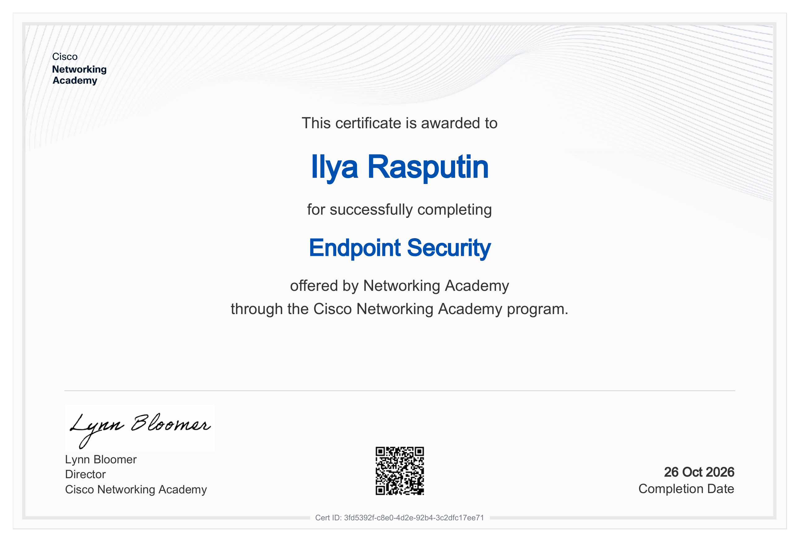

# Endpoint Security - Cisco Networking Academy

Certificate of completion for **Endpoint Security** from **Cisco Networking Academy**.

## Course

**Endpoint Security**

Platform: Cisco Networking Academy

## Main Topics

The course covered key concepts of endpoint security:

- Endpoint security fundamentals;
- Threats targeting endpoints;
- Malware and attack techniques;
- Host-based firewalls and protection mechanisms;
- Antivirus and antimalware solutions;
- Endpoint detection and response (EDR) concepts;
- Device hardening and secure configuration;
- User awareness and security best practices;
- Monitoring and incident response on endpoints.

## Practice

The course included interactive modules, quizzes, and practical exercises focused on understanding endpoint threats and implementing basic protection measures.

**Labs:** [View laboratory works](https://github.com/Buregonitel/cisco-labs/tree/main/Endpoint%20Security)

## Certificate

This certificate confirms the successful completion of **Endpoint Security**.

📄 [Open Certificate](Endpoint-Security-certificate.pdf)

## Verification

Cisco Networking Academy profile:

[My Cisco Networking Academy Profile](https://www.netacad.com/profile?tab=badges)

**Certificate ID:** `3fd5392f-c8e0-4d2e-92b4-3c2dfc17ee71`

## Skills

- Endpoint Security Fundamentals
- Threat Landscape for Endpoints
- Malware Protection
- Host-based Security Controls
- Device Hardening
- Endpoint Detection Concepts
- Security Best Practices
- Incident Awareness

## Status

**Completed ✅**
