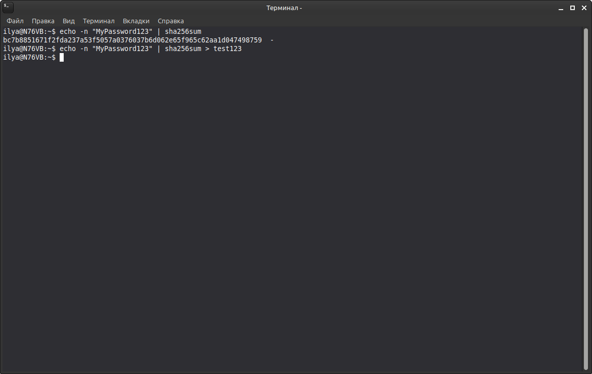
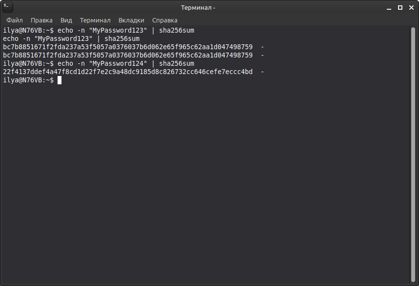
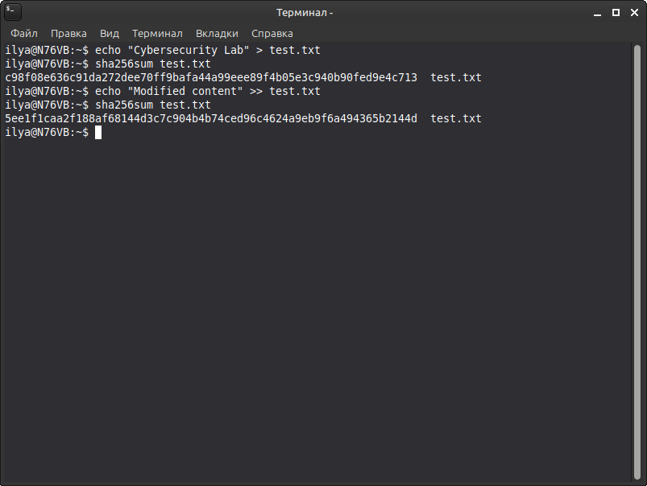
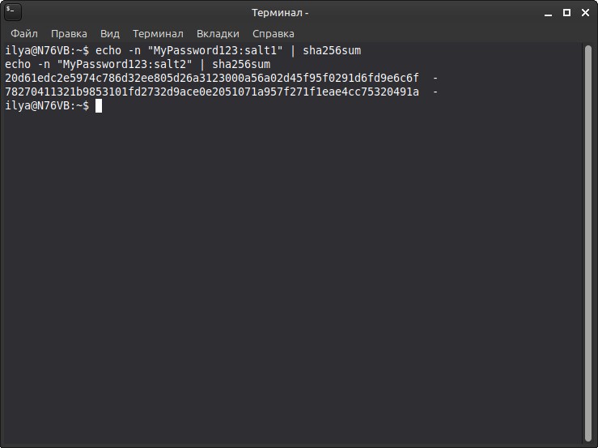

#  Cybersecurity Home Lab: Project #2 - Password & Hash Security 

## Overview

This project is a practical Linux-based laboratory focused on password security, cryptographic hashing, and file integrity verification.

The purpose of this lab is to understand how hashing works, why it is important in cybersecurity, and how cryptographic hashes can be used to verify data integrity.

All experiments are performed locally using Linux command-line tools.

## Objectives

- Understand the difference between hashing and encryption.
- Generate SHA-256 hashes using Linux utilities.
- Observe how small changes in input affect hash outputs.
- Understand the concept of salt in password security.
- Verify file integrity using cryptographic hashes.
- Explore secure password hashing algorithms such as bcrypt and Argon2id.

## Environment & Tools

| Component | Description |
|---|---|
| Operating System | Linux |
| Terminal | Bash |
| Hashing Utility | `sha256sum` |
| Additional Tools | `echo`, `cat` |

## Lab Exercises

### 1. Generating a SHA-256 Hash

Generate a SHA-256 hash from a test password using `sha256sum`:

```bash
echo -n "MyPassword123" | sha256sum
```



**Observation:** The command generates a fixed-length SHA-256 hash from the provided input.

### 2. Comparing Identical Passwords

Generate hashes from identical inputs and compare the results:

```bash
echo -n "MyPassword123" | sha256sum
echo -n "MyPassword123" | sha256sum
```


**Observation:** Identical inputs produce identical SHA-256 hashes. A small change in the input produces a different hash.

### 3. File Integrity Verification

Create a test file and calculate its SHA-256 hash:

```bash
echo "Cybersecurity Lab" > test.txt
sha256sum test.txt
```

Modify the file:

```bash
echo "Modified content" >> test.txt
sha256sum test.txt
```



**Observation:** Changing the file content changes its hash. This demonstrates how cryptographic hashing can help detect file modifications.

### 4. Understanding Salt

Compare hashes generated from the same password combined with different salt values:

```bash
echo -n "MyPassword123:salt1" | sha256sum
echo -n "MyPassword123:salt2" | sha256sum
```



**Observation:** Different salt values produce different hashes, even when the original password remains the same.

> **Note:** This is a simplified demonstration of salting, not a production-ready password storage method. In real password storage, use a dedicated password-hashing algorithm that generates and manages salts, such as Argon2id or bcrypt.

### 5. Password Hashing Algorithms

Explore two password-hashing algorithms:

- **bcrypt** — a password-hashing algorithm designed to make brute-force attacks more expensive.
- **Argon2id** — a modern memory-hard password-hashing algorithm recommended for password storage.

Unlike general-purpose hashing algorithms such as SHA-256, password-hashing algorithms are designed to slow down password-guessing attacks.

## Key Concepts Learned

| Concept | Description |
|---|---|
| Hashing | A one-way transformation of input data into a fixed-length digest |
| Encryption | A reversible transformation using a cryptographic key |
| SHA-256 | A cryptographic hash function from the SHA-2 family |
| Salt | A unique random value added to a password before hashing |
| File Integrity | Verification that data has not been modified |
| bcrypt | A password-hashing algorithm |
| Argon2id | A memory-hard password-hashing algorithm |

## Security Considerations

- SHA-256 should not be used directly for password storage.
- Passwords should be stored using dedicated algorithms such as Argon2id or bcrypt.
- Unique, randomly generated salts help protect against precomputed hash attacks.
- Hashing and encryption serve different security purposes.
- File hashes can detect modifications when compared with a trusted reference hash. A digital signature can additionally help verify authenticity.

## Conclusion

This laboratory provides practical experience with cryptographic hashing and basic password-security concepts using Linux command-line tools.

The exercises demonstrate how SHA-256 works, how input modifications affect hash values, and how hashing can be used to verify file integrity.

This project reinforces fundamental cryptography concepts and provides a foundation for further studies in cybersecurity, particularly Blue Team and SOC operations.

## Disclaimer

This laboratory is intended for educational purposes only.

Use fictional test passwords and sample files for all experiments. Never publish real passwords, password hashes, or sensitive authentication data.
